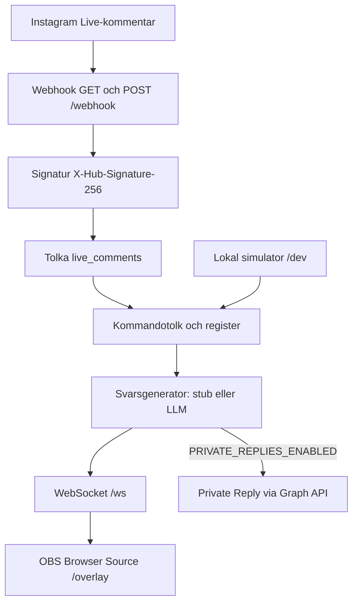

# insta-live-bot

En liten server som lyssnar på kommentarer från en Instagram-sändning, känner igen kommandon som `!fråga`, tar fram ett svar och visar fråga plus svar i en webbsida som OBS kan använda som Browser Source. Vill du kan samma svar också skickas som ett privat meddelande till den som kommenterade.

## Vad Instagrams API tillåter

Live-kommentarer kan läsas **bara medan sändningen pågår**, via webhook-fältet `live_comments`. Kontot måste vara ett professionellt Instagram-konto (företag eller skapare). Appen behöver behörighet att läsa kommentarer (`instagram_manage_comments` eller `instagram_business_manage_comments`, beroende på inloggningstyp) och, om privata svar ska skickas, behörighet att skicka meddelanden (`instagram_manage_messages` eller `instagram_business_manage_messages`). I utveckling får appen bara data från personer som har en roll på appen. För vanliga tittare krävs Advanced Access och App Review.

`GET /{ig-user-id}/live_media` listar media som är live just nu. Den här servern exponerar det anropet på `GET /dev/live-media` när simulatorn är på och `IG_USER_ID` plus `IG_ACCESS_TOKEN` är satta.

Det API:et **inte** tillåter är att posta en publik kommentar eller ett publikt svar på en livesändning. Det enda svaret till tittaren är ett Private Reply: högst ett DM per kommentar, och för Live bara medan sändningen fortfarande pågår. DM:et hamnar i inkorgen om personen följer kontot, annars i förfrågningar. När tittaren svarar gäller det vanliga meddelandefönstret.

Därför är produkten byggd så här: webhook in, kommando ut, svar på overlayn. Det privata DM:et är avstängt tills du slår på det.

## Teknikval

Projektet är TypeScript på Node.js med ESM, utan bundler. `npm run dev` kör källan via `tsx`. `npm run build` kompilerar till `dist/` med `tsc`, och `npm start` kör det med Node.

Node.js 22 eller nyare krävs (`engines` i `package.json`). Koden är skriven och testad på Node.js 22, som är LTS till april 2027, och använder bara sådant som också finns i Node.js 24 och 26 (aktiv LTS när det här skrevs). TypeScript är med för att webhook-payloads, kommandon och overlay-händelser har fasta former: ett nytt kommando är en typad `execute`-funktion, och fel i fältnamn syns när du kompilerar.

Servern är Express. Flödet är ett litet HTTP-API (webhook, statiska filer, ett simulatoranrop) plus en WebSocket, vilket Express täcker utan extra lager. Overlay-sidan är vanlig HTML, CSS och JS som OBS laddar som den är. Tester körs med Vitest.

## Arkitektur



Webhooken svarar `200` så fort signaturen är kontrollerad, och kör kommandot efteråt. Meta skickar om leveransen om svaret dröjer, och samma kommentar körs inte två gånger (id:t sparas i minnet i tio minuter).

Overlayn pratar bara med den här servern. OBS på sändningsdatorn öppnar `http://127.0.0.1:3000/overlay`. Instagram behöver inte nå den sidan. Tunneln (ngrok) behövs bara så att Metas webhook når din maskin.

## Kommandon

Prefixet är `!` om du inte ändrar `COMMAND_PREFIX`.

| Kommando        | Vad det gör                                                                                   |
| --------------- | --------------------------------------------------------------------------------------------- |
| `!fråga <text>` | Tar fram ett svar och visar fråga plus svar på overlayn. Alias: `fraga`, `ask`, `q`.          |
| `!hjälp`        | Listar kommandona på overlayn. Alias: `help`, `hjalp`.                                        |
| `!hej`          | En kort hälsning. Finns som mall för ett kommando som inte anropar LLM. Alias: `hello`, `hi`. |

Vanliga kommentarer utan prefix ignoreras. Okända kommandon ignoreras också, så att ett `!` i chatten inte spammar rutan.

Utan `LLM_API_KEY` är svaret en platshållare som upprepar frågan, så att overlayn går att testa direkt. Med en nyckel anropas `POST {LLM_BASE_URL}/chat/completions` (OpenAI-kompatibelt). Systemprompten är på svenska om du lämnar `LLM_SYSTEM_PROMPT` tom.

## Kom igång

```bash
npm install
cp .env.example .env
npm run dev
```

Öppna sedan:

- [http://127.0.0.1:3000/dev](http://127.0.0.1:3000/dev) — formulär som fejkar en kommentar, med overlayn bredvid
- [http://127.0.0.1:3000/overlay](http://127.0.0.1:3000/overlay) — sidan OBS ska visa
- [http://127.0.0.1:3000/overlay?preview=1](http://127.0.0.1:3000/overlay?preview=1) — ett exempelkort som ligger kvar, bra när du placerar källan

Eller från terminalen, medan servern kör:

```bash
npm run simulate -- "!fråga Vad är huvudstaden i Sverige?"
npm run simulate -- --user=anna "!hjälp"
```

## Meta-app, webhook och ngrok

1. Skapa en app på [developers.facebook.com](https://developers.facebook.com/) och lägg till Instagram. Kontot som sänder ska vara ett professionellt Instagram-konto.
2. Välj Instagram Login eller Facebook Login for Business. Namnen på behörigheterna skiljer sig åt. Ta de som dashboarden visar för kommentarer och, om du vill skicka DM, för meddelanden.
3. Kopiera app secret till `META_APP_SECRET`. Välj en verify token och sätt samma värde i `META_VERIFY_TOKEN`.
4. Sätt `IG_USER_ID` till det professionella kontots id och `IG_ACCESS_TOKEN` till en token för det kontot. Med Facebook Login är det ofta en Page-token, och bas-URL:en kan behöva vara `https://graph.facebook.com` (`GRAPH_API_BASE_URL`).
5. Starta en tunnel mot porten servern lyssnar på:

   ```bash
   ngrok http 3000
   ```

6. I appens webhook-inställningar: callback-URL `https://<din-tunnel>/webhook`, verify token som i `.env`, och prenumerera på fältet `live_comments`.
7. Verifieringen är `GET /webhook` med `hub.mode`, `hub.verify_token` och `hub.challenge`. Stämmer token svarar servern med challenge-strängen.
8. Riktiga leveranser är `POST /webhook` med JSON-kropp. Servern räknar om `X-Hub-Signature-256` (`sha256=` plus HMAC-SHA256 av den råa kroppen med app secret) och kastar bort anropet om den inte stämmer.

Så länge appen är i utveckling kommer bara kommentarer från konton med en roll på appen. Starta en livesändning, kommentera `!fråga …` från ett sådant konto, och kortet ska dyka upp i OBS. `GET /dev/live-media` kan bekräfta att Graph ser en aktiv sändning.

Lämna `PRIVATE_REPLIES_ENABLED` avstängt tills token och behörigheter fungerar. När flaggan är `true` gör servern:

```http
POST https://graph.instagram.com/v25.0/{IG_USER_ID}/messages
Authorization: Bearer {IG_ACCESS_TOKEN}

{
  "recipient": { "comment_id": "<kommentarens id>" },
  "message": { "text": "<svaret>" }
}
```

Versionen styrs av `GRAPH_API_VERSION` (standard `v25.0`). Ett Live-DM måste skickas innan sändningen avslutas, och bara ett meddelande per kommentar.

Simulatorn på `/dev` ska vara av när porten går att nå från internet. Den stängs av automatiskt när `NODE_ENV=production`, om du inte sätter `SIMULATOR_ENABLED=true`.

## OBS Browser Source

1. Lägg till en källa av typen **Browser**.
2. URL: `http://127.0.0.1:3000/overlay`
3. Bredd 1920, höjd 1080 (eller samma som canvasen). Bakgrunden är genomskinlig.
4. Låt källan vara igång under sändningen. Sidan återansluter själv om WebSocketen tappas.
5. Justera placeringen med `?preview=1` om du vill se ett exempelkort. Ta bort parametern efteråt, annars ligger exempelkortet kvar tills en riktig fråga kommer.

Kortet tonar in nere till vänster och försvinner efter `OVERLAY_HIDE_MS` (12 sekunder som standard). `0` betyder att kortet ligger kvar tills nästa händelse. `?debug=1` visar en liten anslutningsrad, användbar när du felsöker, inte i bild.

## Miljövariabler

Se `.env.example`. Inga hemligheter ska committas. `.env` ligger i `.gitignore`.

| Variabel                                                        | Betydelse                                                          |
| --------------------------------------------------------------- | ------------------------------------------------------------------ |
| `PORT`, `HOST`                                                  | Där servern lyssnar. `0.0.0.0` gör att en tunnel når webhooken.    |
| `META_APP_SECRET`                                               | Används bara för att kontrollera webhook-signaturen.               |
| `META_VERIFY_TOKEN`                                             | Måste matcha det du anger hos Meta.                                |
| `IG_USER_ID`, `IG_ACCESS_TOKEN`                                 | Kontot anropen görs som. Krävs för DM och `live_media`.            |
| `GRAPH_API_VERSION`, `GRAPH_API_BASE_URL`                       | Standard `v25.0` och `https://graph.instagram.com`.                |
| `PRIVATE_REPLIES_ENABLED`                                       | `false` som standard.                                              |
| `SIMULATOR_ENABLED`                                             | På utanför production, av i production.                            |
| `COMMAND_PREFIX`                                                | Standard `!`.                                                      |
| `OVERLAY_HIDE_MS`                                               | Hur länge kortet syns.                                             |
| `LLM_API_KEY`, `LLM_BASE_URL`, `LLM_MODEL`, `LLM_SYSTEM_PROMPT` | Valfri OpenAI-kompatibel modell. Tom nyckel ger platshållarsvaret. |

## Skript

| Kommando                         | Gör                                                        |
| -------------------------------- | ---------------------------------------------------------- |
| `npm run dev`                    | Startar servern och laddar om vid ändringar. Läser `.env`. |
| `npm start`                      | Kör den byggda servern.                                    |
| `npm run build`                  | Kompilerar TypeScript till `dist/`.                        |
| `npm test`                       | Kör Vitest en gång.                                        |
| `npm run lint`                   | ESLint och Prettier.                                       |
| `npm run format`                 | Skriver om formateringen.                                  |
| `npm run simulate -- "!fråga …"` | Skickar en fejkad kommentar till servern som redan kör.    |

## Lägga till ett kommando

Skapa ett objekt som uppfyller `Command` och registrera det i `src/commands/builtin.ts`. `!hej` i `src/commands/hello.ts` är den korta mallen. Registret matchar namn och alias utan att bry sig om versaler, med svenska regler (`FRÅGA` och `fråga` är samma kommando).

`execute` får kommentaren, argumenten efter kommandonamnet och registret. Returnera ett `overlay`-kort om något ska synas i sändningen, och `privateReplyText` om ett DM ska kunna skickas. DM:et skickas bara när `PRIVATE_REPLIES_ENABLED` är på.

## Nästa steg

- Finjustera systemprompten mot tonen i sändningen.
- Köa frågor så att ett nytt kort inte skriver över det förra mitt i en mening. I dag ersätter den senaste händelsen det som visas.
- Lägg in en enkel granskning (ordlista, eller att du godkänner frågan innan den syns).
- Slå på privata svar först när en testsändning visar att token, behörighet och timing stämmer. Efter sändningen går det inte att DM:a live-kommentaren.
- Ansök om Advanced Access och App Review innan andra än appens testanvändare ska kunna trigga boten.
- Ingen data sparas på disk. Dedupliceringen och senaste kortet ligger i minnet och försvinner när processen startar om.
